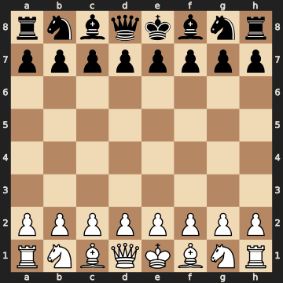

<div align="center">

# Chess Bruh — Philidor Speedrun

An image-based Anki deck inspired by **chessbrah’s Philidor speedrun**, played as **redwinereduction**.


**Look at the board. Recall the played move. Check your reasoning.**

[Get started](#get-started) · [Card format](#card-format) · [Build the deck](#build-the-deck) · [Scope & limitations](#scope--limitations)

</div>

---

## What is this?

A move-by-move study companion to chessbrah’s [Philidor Speedrun playlist](https://youtube.com/playlist?list=PLUjxDD7HNNTiQ-rsy-kKE9uHRBqtNlCUa).

The deck reconstructs positions from public Chess.com game records and turns **every recorded move by redwinereduction** into a question. You study both White and Black, with the board always facing your side.

- **11,046 cards** across **292 games**.
- **10,007 distinct board positions**; repeated positions remain separate cards.
- Rating-band subdecks, plus game and color tags.
- Embedded board images for offline study.
- Engine recommendations shown separately from the moves actually played.

## Card format

<div align="center">

**White to move**



**What move was played here?**

</div>

| Front | Back |
| :--- | :--- |
| Board image, oriented toward our side | **Move actually played** as the main answer |
| Side to move | Secondary Stockfish recommendation and explanation |
| “What move was played here?” | Sample continuation and evaluation |
| No answer arrows | Actual game move and original game link |

> **Best found, not uniquely best.** In many positions, especially openings, several moves are reasonable. An engine recommendation is not necessarily the move that best demonstrates the Philidor setup.

## Get started

1. Download **`Philidor-Speedrun.apkg`** from this repository’s **Releases**, once a release has been published.
2. In Anki desktop, select **File → Import** and choose the package.
3. Open the **Philidor Speedrun** deck and start with a lower-rating subdeck.
4. Sync to AnkiMobile or AnkiDroid if desired.

**Suggested pace:** start with 10–20 new cards a day. Say the move and your reason before revealing the answer.

The deck is self-contained. An internet connection is only needed to open the original game links or sync your collection.

<details>
<summary><strong>Why keep repeated positions?</strong></summary>

The deck preserves every turn rather than selecting only tactical highlights. This includes repeated opening positions and the initial move in White games. For a lighter study schedule, suspend cards you already know or study individual rating bands.

</details>

## Build the deck

### Requirements

- Python 3.10+ on Linux
- Stockfish 17 at `/usr/games/stockfish`
- Cairo system libraries for CairoSVG
- Python dependencies from `requirements.txt`

Example on Debian/Ubuntu:

```bash
sudo apt-get update
sudo apt-get install stockfish libcairo2
python -m venv .venv
source .venv/bin/activate
pip install -r requirements.txt
python scripts/build_deck.py
```

The builder uses the included account archive snapshot, excludes its first 50 unrelated games, reconstructs legal positions, analyses them with Stockfish and packages the cards with their images.

**Outputs** are written to `output/`:

```text
output/
├── Philidor-Speedrun.apkg
├── philidor-games.pgn
├── manifest.json
├── positions.json
├── analysis.json
└── media/
```

Analysis uses **30,000 nodes per distinct position**, six worker processes and one engine thread per worker. Allow time and disk space for roughly 10,000 board images. Results are cached for subsequent runs. To use another Stockfish path or worker count, edit `scripts/build_deck.py`.

## Repository layout

```text
assets/                  Example card image
data/                   Source snapshot and selected-game manifest
scripts/build_deck.py   Deck builder
requirements.txt        Python dependencies
CONTRIBUTING.md         Reporting errors and proposing improvements
RELEASE_CHECKLIST.md    Publishing the downloadable deck
```

## Scope & limitations

### Archive-based coverage

The selection begins with the Philidor run on **14 January 2025** and ends at the account’s final archived game, with a post-game rating of **2501**. The first 50 games belong to an earlier, unrelated opening run and are excluded.

The beginning matches the first episode’s moves and 13-game structure. **The full selection has not been verified frame by frame against all 21 videos.** Later games may include material omitted from the edited series. Rating bands use archived **post-game ratings**, not exact episode boundaries.

### Engine-based answers

Answers use Stockfish 17 with a bounded 30,000-node search. They are not proofs of a unique best move. A difference between the recommendation and the played move **does not by itself mean the played move was a mistake**.

Evaluations are from our side’s perspective: positive is favorable to us. Continuations are illustrative best-found lines, not necessarily forced sequences.

### Explanations are not video commentary

Explanations are generated from board features and engine continuations. They describe immediate checks, captures, piece moves and attacks; they are **not comprehensive positional annotations** or transcriptions of Aman's coaching. An attacked piece may be defended, and an attack may not win material.

## Sources & acknowledgments

- **chessbrah / Aman Hambleton** — the original [Philidor Speedrun series](https://youtube.com/playlist?list=PLUjxDD7HNNTiQ-rsy-kKE9uHRBqtNlCUa).
- **Chess.com** — public game records for [redwinereduction](https://www.chess.com/member/redwinereduction), retrieved through the [Published Data API](https://api.chess.com/pub/player/redwinereduction/games/archives).
- **Stockfish** — engine analysis.
- **python-chess**, **genanki** and **CairoSVG** — reconstruction, packaging and rendering.

This is an independent study project. It is not affiliated with or endorsed by chessbrah, Chess.com, Anki or Stockfish. No video footage or audio is included.

## Feedback

Found an incorrect explanation or an archive game that does not belong to the series? Please open an issue with the **game URL, move number and side to move**. See [CONTRIBUTING.md](CONTRIBUTING.md).
